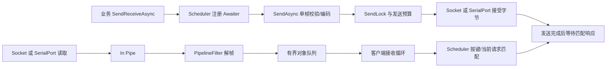

# SuperClient 项目指南

本文帮助新加入的开发者快速理解当前结构、数据流和使用方式。目标框架 .NET 10；生产入口和行为约定见 [README](README.md)，本轮质量评估见 [TEST-COVERAGE](TEST-COVERAGE.md) 与 [CODE-REVIEW](CODE-REVIEW.md)。

## 1. 先运行一次

安装 .NET 10 SDK 后，在仓库根目录执行：

```powershell
dotnet test IFactory.Interaction.SuperClient.slnx -c Release
dotnet run --project examples/LoopbackDemo/LoopbackDemo.csproj -c Release
```

示例在127.0.0.1上创建临时端口的TCP服务端，使用SimplifiedClient发送4字节并等待回显，成功输出：

```text
Sent: 01020304; received: 01020304
```

它不依赖固定端口、真实设备或外网。示例同时演示“初始化完成不等于连接完成”、请求响应、包流消费和正常关闭。源码位于 [examples/LoopbackDemo/Program.cs](examples/LoopbackDemo/Program.cs)，已实际构建并运行。

## 2. 仓库结构

```text
SuperClient/
├─ IFactory.Interaction.SuperClient.slnx     两个工程，AnyCPU/x86映射
├─ IFactory.Interaction.SuperClient/         通信库，源码文件平铺
├─ IFactory.Interaction.SuperClient.Tests/   xUnit单元及loopback集成测试
│  └─ Infrastructure/ControlledChannel.cs    可精确放行/失败的假传输
├─ examples/LoopbackDemo/                    可运行的TCP回环示例（不加入核心解决方案）
├─ scripts/
│  ├─ Measure-Coverage.ps1                   运行覆盖率并输出汇总
│  ├─ Test-QualityMutations.ps1              在隔离快照中恢复错误语义，确认测试能检出
│  └─ Measure-SendLatency.ps1                隔离快照的小包延迟/分配比较
├─ Directory.Build.props                    框架、SDK语言配置、版本及平台输出路径
├─ Directory.Build.targets                  统一应用PackageReference版本
├─ global.json                              稳定版.NET10 SDK选择策略
├─ coverage.runsettings                     仅统计主库，保留串口及分支统计
├─ README.md / PROJECT-GUIDE.md              当前使用与结构文档
├─ TEST-COVERAGE.md / CODE-REVIEW.md          当前测试评估与审查结论
└─ REVIEW.md / FIX-VALIDATION.md             前两轮历史记录
```

`bin/`、`obj/`、`publish/`、`TestResults/`为本地生成目录，不提交。历史讨论工作稿和Workbuddy本地状态也不提交；它们不参与构建和运行。

## 3. 按职责找代码

| 职责 | 入口文件 | 阅读重点 |
| --- | --- | --- |
| 最简单的字节协议客户端 | SimplifiedClient.cs | byte[]编码器、固定长度/固定头/分隔符过滤器 |
| 高层生命周期与请求响应 | SuperClient.cs | 初始化、创建通道、收包调度、重置、代次、断连快照 |
| 公共契约 | ISuperClient.cs、IChannel.cs、IChannelCreator.cs | 高层客户端、底层通道、传输创建器各自的责任 |
| 接收、解包及关闭 | PipeChannel.cs | In管道、filter切换、包长、包队列、EOF、首故障与清理 |
| 发送完成与异常 | PipeChannel.Send.cs | 等锁/发送预算、部分发送、逐调用完成、错误传播 |
| 有界编码缓冲 | LimitedPipeWriter.cs | 在分配请求与Advance处限制单帧长度 |
| TCP连接与数据传输 | TcpChannelCreator.cs、TcpPipeChannel.cs | 客户端重连、服务端accept、临时监听端口、Socket I/O |
| UDP连接与数据传输 | UdpChannelCreator.cs、UdpPipeChannel.cs | 绑定、组播配置、数据报边界、空包、最大负载 |
| 串口配置与传输 | SerialIOEndPoint.cs、SerialIOChannelCreator.cs、SerialIOPipeChannel.cs | 参数校验、显式可选连接恢复、驱动取消边界 |
| 响应匹配 | ImmediatePackageScheduler.cs、KeyPackageScheduler.cs | 无键串行、有键并发、重复键拒绝、迟到/未匹配包 |
| 等待响应 | ImmediatePackageAwaiter.cs、KeyPackageAwaiter.cs | 异步完成、超时、条件移除原注册 |
| 对象队列/按需接收 | DefaultObjectPipe.cs | 容量限制、完成与排空、分片时继续请求输入 |
| 配置与诊断 | ChannelOptions.cs、ChannelUri.cs、ChannelTransportException.cs、ChannelDisconnectedEventArgs.cs | URI覆盖选项、异常中的字节数、已关闭通道快照 |

主库依赖SuperSocket.ProtoBase解包契约、Logging.Abstractions和System.IO.Ports。Pipelines由.NET10提供。测试的coverlet.collector仅用于开发时测量，PrivateAssets=all，不成为主库运行依赖。

## 4. 数据怎样流动



关键点：注册等待者在发送之前，所以设备响应很快也不会漏掉；发送成功不等于设备收到或执行。发送途中失败可能已经发出部分内容，库不会自行重发。

TCP与串口是字节流，不能把一次Read当成一帧。filter必须保留半帧、只消费当前完整帧，避免吞粘包。NextFilter切换时传递Context并重置旧filter；同一个可变filter实例不要共享给多个独立客户端。

UDP每次公共SendAsync对应一个数据报，允许主动发送空报文；接收空数据报会跳过，不按EOF处理。接收侧仍经filter解析；UDP不保证顺序、送达或业务匹配。

高级IPipeChannel.Out是无调用边界的低层流入口。多个合法帧可能合并成一个读取批次，因此批次长度不能直接等同单帧长度；它也不具有公共SendAsync的逐调用完成通知。优先使用公共发送接口。

## 5. 如何选择API

| 需求 | 选择 |
| --- | --- |
| 发送接收byte[]、协议简单 | SimplifiedClient |
| 自定义发送/接收对象、请求号匹配 | SuperClient<TSend,TReceive> + filter + encoder + scheduler |
| 同时只有一个请求、无请求编号 | ImmediatePackageScheduler；客户端自动串行化SendReceive |
| 多请求并行、响应可乱序 | KeyPackageScheduler；包实现IKeyedPackageInfo<TKey>，每个在途键唯一 |
| 只负责监听/连接，自己消费包流 | TcpChannelCreator或UdpChannelCreator；回调中Start，再RunAsync消费 |
| 现成socket/串口、自定义生命周期 | 直接构造相应PipeChannel；负责Start、单消费者和CloseAsync |

有键调度器必须使用完整发送对象的SendReceiveAsync重载；原始字节重载没有关联键，会被拒绝。无键协议无法可靠区分上一请求的迟到响应，应改进协议或明确超时后的连接恢复策略。

独立无键调度器可实现ISerializedRequestScheduler声明需要串行请求；自定义实现还要负责自身的断连清理。UnmatchedPackages是未匹配计数，包括已交给主动上报处理器的包，不能当作丢包数。

## 6. 选择解包器

- `FixedSizePipelineFilter(n)`：每n字节一帧，返回完整帧；n必须为正。
- `TerminatorPipelineFilter(delimiter)`：遇分隔符返回一帧，结果不含分隔符；分隔符不可为空。
- `FixedHeaderPipelineFilter(headerSize)`：继承并实现GetBodyLengthFromHeader；返回值是包体长度，完整结果默认含头部。负长度或头体长度溢出会成为协议错误。
- 复杂对象协议：实现/继承SuperSocket.ProtoBase的IPipelineFilter<T>与IPackageEncoder<T>，而不是把业务解析塞到传输类。

修改协议时，至少测试：半帧、多个粘连帧、非零reader位置、跨段输入、非法长度、最大长度、EOF不完整帧，以及NextFilter/Context/Reset的状态切换。

## 7. 初始化、连接、关闭与重连

1. 构造客户端后先观察Initialization，它反映配置和创建器启动；TCP建立连接或开启串口恢复后等待端口可用，可能发生在稍后。
2. 订阅ChannelCreated后再检查Channel，可避免连接已经建立而错过通知。回环示例提供了完整的WaitForConnectionAsync写法。
3. 用Disconnected事件中的args.Channel、args.Identity、args.Reason记录关闭快照。回调触发时client.Channel可能已经清空或换成新连接。
4. DisposeChannelAsync关闭当前传输与创建器；ResetChannelAsync串行地关闭、重置filter并创建新传输。await using适合拥有完整客户端生命周期的调用方。
5. 重连使用连接代次隔离；新连接建立时结束内置调度器的旧请求，旧接收回调收尾不能清掉新请求。不要跨连接延续有副作用命令，也不要让回调长期阻塞。

TCP客户端自动连接恢复；TCP服务端依次接受单个活动连接。串口SerialReconnect默认false，显式开启后只恢复连接，不重放命令。本地、应用和协议错误始终停止串口恢复；InternalError（包括队列容量错误）默认停止，可通过SerialReconnectOnInternalError显式允许有界退避恢复。每次打开均使用SerialOpenRetryTimeout宽限；完整策略见README。内置DetachAsync统一不支持。

## 8. 时间预算与资源边界

- SendTimeout：一次公共发送的准备、等锁与传输预算；0禁用。同步用户编码器不能被强制中断，只能在其返回后观察超时。
- SendReceiveAsync(millisecondsTimeout)：仅发送完成后的响应等待，不含请求排队或发送；-1无限等待。发送阶段失败抛异常，响应阶段超时/断连返回null。
- ReceiveTimeout：单次读取空闲等待；配置后即使协议正常，空闲也会断连，不等于完整事务或整帧组装超时。
- ConnectTimeout：单次TCP连接尝试；默认5000ms，失败进入有上限退避。服务端Accept不套此连接期限。
- MaxPackageLength限制接收帧和公共发送帧，MaxPendingPackages限制解码后待消费包数。容量溢出以InternalError关闭，不误报ProtocolError。

完整参数默认值、异常表与内存估算以README为准。直接传入的自定义In/Out不得跨重连复用已完成的管道。

## 9. 改代码之前先跑什么

```powershell
dotnet build IFactory.Interaction.SuperClient.slnx -c Release -warnaserror
dotnet test IFactory.Interaction.SuperClient.slnx -c Release
./scripts/Measure-Coverage.ps1
```

修改发送、关闭或重连时，同时运行隔离故障变异脚本；修改平台构建时，先构建AnyCPU、再x86、最后默认`dotnet test --no-build`，确认路径和哈希没有被覆盖。本机COM1–COM2的原生I/O现已验证，重跑见 [SERIAL-VALIDATION.md](SERIAL-VALIDATION.md)；物理设备、组播、多平台和现场负载仍不能用该结果替代。
